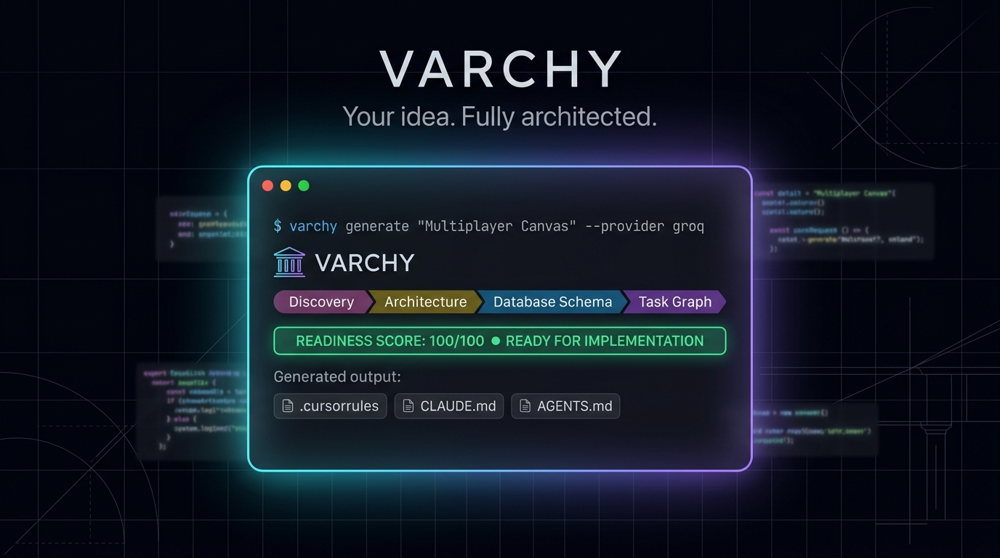

# VARCHY 🏛️
### *Your idea. Fully architected.*

<p align="center">
  
</p>

<p align="center">
  <a href="https://pypi.org/project/varchy/"></a>
  <a href="https://pypi.org/project/varchy/"></a>
  <a href="https://github.com/devFiend/varchy"></a>
  <a href="https://python.org"></a>
  <a href="https://modelcontextprotocol.io"></a>
  <a href="#"></a>
  <a href="#"></a>
  <a href="#"></a>
</p>

<p align="center">
  <strong>Varchy</strong> is the open-source software architect and planning orchestrator for the AI coding era.<br>
  It transforms a <strong>one-sentence idea</strong> into a complete, structured, mathematically validated, and implementation-ready engineering blueprint before a single line of application code is written.
</p>

---

## ⚡ The Problem: The "Vibe Coding" Hangover

AI coding assistants (Cursor, Claude Code, GitHub Copilot, Gemini CLI) write code in seconds. But without upfront architecture, developers inevitably face the same disaster:

```
❌ Vibe Coding Without Architecture:
   Prompt: "Build me an Uber for dog walkers"
     ↳ Agent hallucinates database models on the fly
     ↳ Screen routes conflict with backend API contracts
     ↳ Edge cases, state machines, and auth are forgotten
     ↳ Context window fills up -> Agent forgets earlier decisions
     ↳ Hours wasted debugging spaghetti code and broken dependencies
```

```
✅ Vibe Coding With Varchy:
   Command: varchy generate --idea "Uber for dog walkers" --template saas
     ↳ Structured PRD with stable requirement IDs (REQ-001)
     ↳ Screen specs & interaction states (SCREEN-001)
     ↳ Relational schemas & API contracts (ENT-001, API-001)
     ↳ Phased task DAG with zero circular dependencies (TASK-001)
     ↳ 100-Point Deterministic Readiness Gate verification
     ↳ Exported AGENTS.md, CLAUDE.md, GEMINI.md, .cursorrules, & Copilot rules
     ↳ Your coding agent implements tasks in perfect sequence!
```

---

## ❓ Frequently Asked Before Getting Started

### 1. Do I need to clone the Varchy repository to use it?
**No! You do not need to clone the repository or touch Python code.**
Varchy is a command-line tool distributed via PyPI. You install it once via `pip3` / `pip`, and you can run the `varchy` command inside **any folder on your computer** (an empty folder where you want to start a new project, or an existing project).

### 2. Which AI does Varchy use? Why did it work without an API key?
Varchy features a **dual-engine architecture**:
1. **Built-in Offline Engine (Default):** If you don't provide an API key, Varchy doesn't fail or crash. Instead, it activates its built-in deterministic engine that generates complete, fully valid architectural blueprints offline with zero network requests and zero cost.
2. **Live Cloud & Local AI Models (BYOK):** When you want production-grade, nuanced AI thinking for novel ideas, Varchy connects directly to **OpenAI** (`gpt-4o`, `o3-mini`), **Google Gemini** (`gemini-2.5-pro`, `gemini-2.5-flash`), **xAI Grok** (`grok-2`), or **Ollama** (free local models like `llama3` or `deepseek-r1`). See [AI Provider Configuration](#-how-ai-providers-work-in-varchy) below.

---

## 🚀 Installation & Troubleshooting

### Standard Installation

Open your terminal and run:

```bash
# macOS / Linux (Recommended)
pip3 install varchy

# Windows
pip install varchy
```

---

### 💡 Troubleshooting Common Installation Errors

#### Error: `zsh: command not found: pip`
If you run `pip install varchy` on macOS and see:
```text
devfiend@Matthews-MacBook-Air ~ % pip install varchy
zsh: command not found: pip
```

**Why this happens:** Modern macOS and Linux distributions do not alias the plain `pip` command to avoid conflicting with system Python. Instead, Python installs `pip3`.

**Solutions (in order of recommendation):**

1. **Use `pip3` directly:**
   ```bash
   pip3 install varchy
   ```

2. **Use the Python module launcher (always works):**
   ```bash
   python3 -m pip install varchy
   ```

3. **If you see `No module named pip`:**
   ```bash
   python3 -m ensurepip --upgrade
   python3 -m pip install --upgrade pip
   python3 -m pip install varchy
   ```

4. **Verify your Python and pip installation:**
   ```bash
   python3 --version
   python3 -m pip --version
   ```

5. *(Optional)* Alias `pip` to `pip3` permanently in your shell:
   ```bash
   echo 'alias pip="pip3"' >> ~/.zshrc && source ~/.zshrc
   ```

#### Upgrading Varchy to the Latest Version
```bash
pip3 install --upgrade varchy
```

#### Verifying Installation
Run:
```bash
varchy --version
varchy doctor
```

---

## 🧠 How AI Providers Work in Varchy

Varchy supports a **Bring-Your-Own-Key (BYOK)** model. Your API keys are stored securely in your operating system's hardware-backed Keychain (`keyring`) or read from environment variables. Keys **never** touch git, files on disk, logs, or external servers.

| Provider | Model Family | Key Required? | Cost | Best For |
|---|---|:---:|:---:|---|
| **Built-in Offline Engine** | Internal Blueprint Engine | **None** | Free | Instant blueprints, offline work, CI/CD, testing |
| **Groq (LPU Ultra-Fast)** | `openai/gpt-oss-120b`, `openai/gpt-oss-20b`, `llama-3.3-70b-versatile` | Yes (Free Key at console.groq.com) | Free Tier Available | Sub-second architectural generation & LPU speed |
| **OpenAI** | `gpt-4o`, `gpt-4o-mini`, `o3-mini` | Yes (API Key) | Pay per token | Enterprise systems, strict schema logic |
| **Google Gemini** | `gemini-2.5-pro`, `gemini-2.5-flash` | Yes (API Key) | Pay per token | Deep architectural reasoning & long context |
| **xAI Grok** | `grok-2` | Yes (API Key) | Pay per token | Rapid ideation & modern system design |
| **Ollama** | `llama3`, `deepseek-r1`, `qwen2.5` | **None** | Free | 100% private local LLM running on your GPU/CPU |

### Option A: Using the Free Built-in Offline Engine (Zero Setup)
No configuration is needed! Just run:
```bash
varchy generate --idea "A realtime task tracker" --template saas
```
*(Uses the deterministic blueprint generator with zero network calls and zero cost).*

---

### Option B: Connecting Cloud AI (Groq, OpenAI, Gemini, Grok)

You can save your API keys securely into your OS Keychain:

```bash
# Save Groq key (Ultra-fast LPUs, free key at console.groq.com)
varchy config set-key groq gsk_...

# Save OpenAI key (securely stored in OS Keychain)
varchy config set-key openai sk-proj-...

# Save Google Gemini key
varchy config set-key gemini AIzaSy...

# Save xAI Grok key
varchy config set-key grok xai-...
```

*Alternatively, you can set standard environment variables:*
```bash
export GROQ_API_KEY="gsk_..."
export OPENAI_API_KEY="sk-proj-..."
export GEMINI_API_KEY="AIzaSy..."
export XAI_API_KEY="xai-..."
```

Then generate using your preferred provider and model:
```bash
# Using Groq (Blazing fast LPU inference)
varchy generate --idea "A realtime collaborative kanban board" --provider groq

# Using OpenAI GPT-4o
varchy generate --idea "A peer-to-peer equipment rental marketplace" --provider openai --model gpt-4o

# Using Google Gemini 2.5 Pro
varchy generate --idea "A multi-tenant billing & metering platform" --provider gemini --model gemini-2.5-pro

# Using xAI Grok
varchy generate --idea "A real-time crypto telemetry dashboard" --provider grok --model grok-2
```

---

### Option C: Using Ollama for 100% Free, Private Local AI

If you want live LLM generation without paying for API keys or sending code to the cloud:

1. Install and start [Ollama](https://ollama.com):
   ```bash
   ollama run llama3
   ```
2. Run Varchy pointing to Ollama:
   ```bash
   varchy generate --idea "A local-first encrypted notes app" --provider ollama --model llama3
   ```

---

### Inspecting Configured Providers & Models

Check what providers and keys are currently recognized on your machine:

```bash
# List all providers and their authentication status
varchy providers

# List all available models across providers
varchy models

# Diagnose system health, Python environment, and OS Keychain
varchy doctor
```

---

## 📖 The Complete Step-by-Step User Journey

Here is how a developer goes from an idea to a fully functioning application built by an AI coding agent:

```
┌────────────────────────────────────────────────────────────────────────┐
│                          THE VARCHY WORKFLOW                           │
├─────────────┬──────────────────────────────────────────────────────────┤
│ 1. Scaffolding│ mkdir my-app && cd my-app                              │
│ 2. Archetype │ varchy templates                                         │
│ 3. Blueprint │ varchy generate --idea "..." --template saas            │
│ 4. Validation│ varchy validate                                         │
│ 5. Agent Run │ Cursor / Claude Code reads .cursorrules or AGENTS.md    │
│ 6. Handoff   │ varchy task next                                        │
│ 7. Iteration │ varchy update --requirement REQ-001 ...                 │
└─────────────┴──────────────────────────────────────────────────────────┘
```

### Step 1: Create a Project Directory
Open your terminal and navigate to where you want your new project to live:
```bash
mkdir my-saas-app
cd my-saas-app
```

### Step 2: Browse Architectural Templates
Explore pre-tuned architectural archetypes:
```bash
varchy templates
```
Available archetypes include:
- `saas`: Multi-tenant web platform with RBAC, PostgreSQL schema, Stripe billing, and auth.
- `local_first`: Encrypted zero-knowledge offline-first client application with CRDT sync.
- `api_backend`: High-throughput microservice / headless REST & RPC backend.
- `dev_tool`: Ergonomic CLI developer utility with local configuration & state.
- `mobile_app`: Offline-ready cross-platform mobile application.

Inspect any template:
```bash
varchy templates inspect saas
```

### Step 3: Generate the Architectural Blueprint
Run `varchy generate` with your idea:
```bash
varchy generate --idea "A collaborative bug tracking platform for remote hardware teams" --template saas
```

*Want an interactive discovery session?*
```bash
varchy generate --idea "A telemedicine booking platform" --mode interactive
```
*Varchy will ask clarifying questions to nail down edge cases, authentication preferences, and non-functional requirements before generating.*

### Step 4: Run the 100-Point Deterministic Readiness Gate
Ensure your architecture has zero missing contracts, orphan entities, or circular task dependencies:
```bash
varchy validate
```

```text
       🏛️ Blueprint Readiness Assessment (100-Point Deterministic Score)
┏━━━━━━━━━━━━━━━━━━━━━━━━━━━━━┳━━━━━┳━━━━━━━┳━━━━━━━━┓
┃ Category                    ┃ Max ┃ Score ┃ Status ┃
┡━━━━━━━━━━━━━━━━━━━━━━━━━━━━━╇━━━━━╇━━━━━━━╇━━━━━━━━┩
│ Product Requirements        │  20 │  20.0 │  PASS  │
│ Technical Architecture      │  20 │  20.0 │  PASS  │
│ UI/UX Specifications        │  15 │  15.0 │  PASS  │
│ Development Planning        │  15 │  15.0 │  PASS  │
│ Database & API Contracts    │  10 │  10.0 │  PASS  │
│ Testing Strategy            │  10 │  10.0 │  PASS  │
│ Security & Deployment       │  10 │  10.0 │  PASS  │
└─────────────────────────────┴─────┴───────┴────────┘
Total Readiness Score: 100.0 / 100 — READY FOR IMPLEMENTATION
Critical Blockers: 0 | Warnings: 0 | Recommendations: 0
```

### Step 5: Feed Tasks to Your Coding Agent
Open your project in **Cursor**, **VS Code**, or launch **Claude Code**:
```bash
cursor .
```

Ask your coding agent:
> *"Read `.cursorrules` and `docs/04-development/` and implement the next uncompleted task."*

Or run Varchy's task router directly from the command line:
```bash
varchy task next
```

```text
╭─ 🏛️ Varchy Task Handoff ────────────────────────────────────────────────────────╮
│ Next Actionable Implementation Task: [TASK-001]                                 │
│ Title: Repository Scaffolding & Configuration                                   │
│ Phase: PHASE-1 | Priority: critical                                             │
│ Description: Initialize project directory structure, config, and core deps...  │
│                                                                                 │
│ Associated Requirements:                                                        │
│   • [REQ-001] Core Multi-Tenant Engine                                          │
│                                                                                 │
│ Completion Criteria:                                                            │
│   • Project installs cleanly in fresh virtual environment                       │
│   • Core linting, typing, and test suites pass                                  │
╰─────────────────────────────────────────────────────────────────────────────────╯
```

List all tasks organized by phase:
```bash
varchy task list
```

### Step 6: Incrementally Update Requirements Without Breaking History
When project requirements change mid-development, update only what changed without blowing away your previous work:
```bash
varchy update --requirement REQ-001 --title "Enhanced RBAC with SSO" --acceptance-criteria "['Support SAML 2.0', 'Support Okta OIDC']"
```

Re-export and re-validate automatically:
```bash
varchy export
varchy validate
```

---

## 🤖 Coding Agent Integration

Varchy automatically generates tailored configuration files for every major AI coding assistant:

| Tool | Generated Configuration File | How It Works |
|---|---|---|
| **Cursor** | `.cursorrules` | Cursor Composer automatically respects your database schemas, API contracts, and task ordering. |
| **Claude Code** | `CLAUDE.md` | Claude loads project architecture rules into memory at start. |
| **Gemini CLI** | `GEMINI.md` | Gemini Agent CLI adopts architectural constraints and requirement traceability. |
| **GitHub Copilot** | `.github/copilot-instructions.md` | Copilot Chat abides by architectural contracts and guidelines. |
| **Universal Agents** | `AGENTS.md` | Standard markdown specification for any autonomous coding agent. |

---

## 🔌 Model Context Protocol (MCP) Integration

Connect Varchy directly to **Cursor**, **Claude Desktop**, or any MCP-compatible environment as a live intelligence server:

### Cursor Setup (`~/.cursor/mcp.json` or `.cursor/mcp.json`)
```json
{
  "mcpServers": {
    "varchy": {
      "command": "varchy",
      "args": ["mcp", "run"]
    }
  }
}
```

### Claude Desktop Setup (`claude_desktop_config.json`)
```json
{
  "mcpServers": {
    "varchy": {
      "command": "varchy",
      "args": ["mcp", "run"]
    }
  }
}
```

### Live MCP Features
- **Tools:**
  - `varchy_initialize_project`: Initialize project workspace from an MCP prompt.
  - `varchy_generate_blueprint`: Run the 10-stage DAG pipeline.
  - `varchy_validate_blueprint`: Run deterministic 100-point validation.
  - `varchy_get_context`: Fetch full context for any requirement (`REQ-###`) or task (`TASK-###`).
- **Realtime Resources:**
  - `varchy://project/overview`
  - `varchy://project/prd`
  - `varchy://project/architecture`
  - `varchy://project/database` (includes Mermaid ER diagrams)
  - `varchy://project/tasks`
  - `varchy://project/validation`
- **Reusable Prompts:**
  - `review_architecture`: Live readiness check with blocker analysis.
  - `prepare_task_implementation`: Packages requirements, database models, and acceptance criteria for a given `TASK-###`.

---

## 🛠️ Complete CLI Command Reference

| Command | Description | Example |
|---|---|---|
| `varchy init` | Initialize a new project workspace | `varchy init --name "ShopSync" --template saas` |
| `varchy templates` | List all available architectural archetypes | `varchy templates` |
| `varchy templates inspect` | Inspect details of an archetype | `varchy templates inspect saas` |
| `varchy analyze` | Perform pre-generation domain and risk analysis | `varchy analyze --idea "..."` |
| `varchy generate` | Execute 10-stage architecture DAG pipeline | `varchy generate --idea "..." --template saas` |
| `varchy validate` | Run 100-point deterministic readiness scoring | `varchy validate` |
| `varchy task next` | Output the next actionable task in dependency DAG | `varchy task next` |
| `varchy task list` | Display all development tasks grouped by phase | `varchy task list` |
| `varchy update` | Update a specific requirement or component | `varchy update --requirement REQ-001 ...` |
| `varchy export` | Re-compile markdown documentation & agent files | `varchy export` |
| `varchy status` | Show current blueprint health, stages, and metrics | `varchy status` |
| `varchy providers` | List supported AI providers & auth status | `varchy providers` |
| `varchy models` | List recommended models per provider | `varchy models` |
| `varchy doctor` | Diagnose environment, Keychain, and setup | `varchy doctor` |
| `varchy config set-key` | Securely store provider key in OS Keychain | `varchy config set-key openai sk-...` |
| `varchy mcp run` | Launch Model Context Protocol server over stdio | `varchy mcp run` |

---

## 📁 Generated Project Layout

When Varchy generates an architecture, your project directory looks like this:

```text
my-project/
├── .varchy/                       # Machine System of Record (Git-ignored)
│   ├── project.json               # Metadata & configuration
│   ├── checkpoints/               # Atomic stage transaction snapshots (crash-resilient)
│   └── blueprints/current.json    # Master typed Pydantic domain models
│
├── docs/                          # Compiled Engineering Specifications (Git-ignored)
│   ├── 01-product/                # PRD, requirements, user personas
│   ├── 02-design/                 # Design system, screen specs, UI states
│   ├── 03-engineering/            # Tech stack, DB schema (Mermaid ER), API contracts
│   ├── 04-development/            # Phased task roadmap with dependency DAG
│   └── 05-quality/                # Test strategies, unit/integration test cases
│
├── AGENTS.md                      # Universal Coding Agent Guidelines
├── CLAUDE.md                      # Claude Code instructions
├── GEMINI.md                      # Gemini CLI instructions
├── .cursorrules                   # Cursor IDE Composer / Agent rules
├── .github/copilot-instructions.md # GitHub Copilot guidelines
└── README.md                      # Project architectural summary
```

> [!NOTE]
> `.varchy/` and `docs/` are gitignored by default so they do not pollute your application repository. The master blueprint lives in `.varchy/blueprints/current.json`, and all human-readable docs are automatically compiled from it.

---

## 🧪 Testing & Verification

Varchy is engineered with a strict 100-level automated test harness covering all CLI commands, validation algorithms, DAG cycle detection, and MCP endpoints:

```bash
pytest -v
```

```text
tests/test_cli.py ...                                                    [ 11%]
tests/test_cli_advanced.py ......                                        [ 34%]
tests/test_cli_tasks_and_ide.py ..                                       [ 42%]
tests/test_engine_unified.py .                                           [ 46%]
tests/test_mcp_extended.py .                                             [ 50%]
tests/test_pipeline_stages.py ..                                         [ 57%]
tests/test_schemas.py ...                                                [ 69%]
tests/test_templates_and_updates.py .....                                [ 88%]
tests/test_validation_engine.py ...                                      [100%]

============================= 26 passed in 18.48s ==============================
```

---

## 🤝 Contributing

Contributions are warmly welcomed! Please read [CONTRIBUTING.md](CONTRIBUTING.md) to get started.

---

## ⚖️ License

Distributed under the MIT License. See [LICENSE](LICENSE) for more information.
